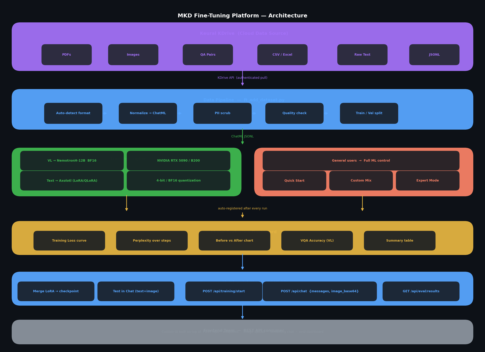

# MKD Fine-Tuning Platform v1.0.0

Production-grade fine-tuning platform for **NVIDIA GPUs** supporting text and vision-language (VL) models. Gradio 6.x UI + FastAPI REST API, containerised with Docker.

---

## Evaluate this project

Start with the [architecture](#architecture), [deployment instructions](#deployment), and [API specification](API_SPEC.md). The UI uses Gradio, the REST API uses FastAPI, and GPU workloads require NVIDIA hardware.

**Validation scope:** the repository documents tests and a training configuration, but this presentation update did not execute a GPU training run. No new training metrics or UI screenshots are claimed. Consult the [CI runs](https://github.com/mkd-hika/MKD--Finetuning-platform/actions) for the current automated-check status.

**License:** the repository currently states internal use for MKD Co., Ltd. Public visibility does not grant an open-source license.


## Architecture



```
┌─────────────────────────────────────────────────────────────┐
│                        app.py (entry)                        │
│   Gradio 6.x  ──►  ui/layout.py  ──►  ui/components.py     │
│                         ui/styles.py (CSS)                   │
└──────────────────────────────┬──────────────────────────────┘
                               │ HTTP
┌──────────────────────────────▼──────────────────────────────┐
│                      api.py (FastAPI)                        │
│  TrustedHostMiddleware ► CORS ► Auth ► Pydantic validators  │
│                                                              │
│  /api/datasets   /api/models   /api/training                 │
│  /api/eval       /api/export   /api/publish                  │
│  /api/chat       /api/health   /api/status                   │
└─────────┬──────────────────────────────────┬────────────────┘
          │                                  │
┌─────────▼──────────┐            ┌──────────▼──────────┐
│   ft_platform/     │            │    inference/        │
│   log_parser.py    │            │    state.py          │
│   eval_dashboard.py│            │    vllm_server.py    │
│   training.py      │            │    chat.py           │
└────────────────────┘            └─────────────────────┘
          │                                  │
┌─────────▼──────────────────────────────────▼────────────────┐
│                  scripts/  (CLI entry points)                 │
│  ft  ft_train.py  ft_eval.py  ft_export.py  ft_configure.py │
└─────────────────────────────────────────────────────────────┘
```

---

## Security Model

| Layer | Mechanism |
|-------|-----------|
| UI access | `ADMIN_PASSWORD` env var → Gradio HTTP basic auth |
| API access | `API_SECRET` env var → `Authorization: Bearer <token>` header |
| Host validation | `TrustedHostMiddleware`; `ALLOWED_HOSTS` env var |
| Input sanitisation | `_safe_name()` rejects `..`, `/`, null bytes on every file-access endpoint |
| Request validation | Pydantic `Field(max_length=…, ge=…, le=…, pattern=…)` on all request models |
| HF token | `HF_TOKEN` read from server env only — never accepted in request bodies |
| Supply-chain | `REVISION_SHA` pins the HF Hub commit SHA passed to every `from_pretrained` |
| Container | Non-root `mkd` user; NVIDIA base image |

### Auth flow

```
Browser ──► ADMIN_PASSWORD (HTTP basic) ──► Gradio UI
REST client ──► Authorization: Bearer $API_SECRET ──► FastAPI
```

Both are optional in development (`""` disables the check).

---

## Deployment

### Docker (recommended)

```bash
# Build
docker build -t mkd-finetuning-platform:v1.0.0 .

# Run (single container)
docker run --gpus all -p 7860:7860 -p 8000:8000 \
  -e ADMIN_PASSWORD=<secret> \
  -e API_SECRET=<secret> \
  -e HF_TOKEN=<hf_token> \
  -e ALLOWED_HOSTS="localhost,*.mkd.kr" \
  -v /data/ft-projects:/workspace/ft-projects \
  mkd-finetuning-platform:v1.0.0

# Full stack (api + ui + redis)
docker compose up
```

### Bare metal

```bash
# Install Python ≥ 3.10 + CUDA 12.4+ runtime first
pip install -e ".[api,dev]"

# Launch API (port 8000)
ADMIN_PASSWORD=<secret> API_SECRET=<secret> uvicorn api:app --host 0.0.0.0 --port 8000

# Launch UI (port 7860)
python app.py
```

---

## Environment Variables

| Variable | Required | Default | Description |
|----------|----------|---------|-------------|
| `ADMIN_PASSWORD` | No | `""` | Gradio HTTP basic auth password (unprotected if empty) |
| `API_SECRET` | No | `""` | FastAPI Bearer token (unprotected if empty) |
| `HF_TOKEN` | For publish | — | Hugging Face write token for model publishing |
| `ALLOWED_HOSTS` | Prod | `localhost,127.0.0.1,*.mkd.kr` | Comma-separated allowed `Host` headers |
| `FT_PROJECT` | No | CWD | Root directory for datasets, models, checkpoints, logs |
| `MODEL_REVISION_SHA` | No | `None` (main) | Pinned HF Hub commit SHA for supply-chain protection |
| `REDIS_URL` | No | — | Redis URL for job queuing in multi-worker deployments |
| `CUDA_VISIBLE_DEVICES` | No | all | GPU device selection |

---

## Quick Start

```bash
# 1. Install
pip install -e ".[api]"

# 2. Launch
python app.py            # Gradio UI  → http://localhost:7860
uvicorn api:app          # REST API   → http://localhost:8000

# 3. Add a model
curl -X POST http://localhost:8000/api/models/add \
  -H "Authorization: Bearer $API_SECRET" \
  -H "Content-Type: application/json" \
  -d '{"hf_model_id": "google/gemma-4-12b"}'

# 4. Add a dataset
curl -X POST http://localhost:8000/api/datasets/add \
  -d '{"source": "hf://my-org/my-dataset"}'

# 5. Start training
curl -X POST http://localhost:8000/api/training/start \
  -d '{"model": "Gemma 4 12B", "dataset": "my-dataset"}'
```

---

## Project Structure

```
MKD--Finetuning-platform/
├── app.py                      # Entry point — Gradio UI launcher
├── api.py                      # FastAPI REST API (port 8000)
├── vl_trainer.py               # Vision-language fine-tuning trainer
├── pyproject.toml              # PEP 621 package metadata
├── Dockerfile                  # Multi-stage NVIDIA CUDA image
├── docker-compose.yml          # api + ui + redis services
├── Makefile                    # test / lint / format / docker targets
│
├── inference/
│   ├── state.py                # Global state, locks, env constants
│   ├── vllm_server.py          # vLLM server lifecycle management
│   └── chat.py                 # Model loading + generation (GPU-required)
│
├── ft_platform/
│   ├── log_parser.py           # Training log → structured metrics
│   ├── eval_dashboard.py       # Matplotlib eval charts
│   └── training.py             # Subprocess wrapper for training runs
│
├── ui/
│   ├── layout.py               # Gradio Blocks definition
│   ├── components.py           # HTML panels, file readers, GPU stats
│   └── styles.py               # Global CSS
│
├── scripts/                    # CLI entry points (ft, ft_train, ft_eval, …)
├── tests/                      # pytest suite (177 tests, 81 % coverage)
│   ├── conftest.py
│   ├── inference/
│   ├── platform/
│   ├── ui/
│   ├── integration/
│   ├── security/
│   └── performance/
│
├── API_SPEC.md                 # Full REST API reference
├── FRONTEND_CONTRACT.md        # Request/response contract for UI integration
├── CHANGELOG.md                # All changes from the original monolith
└── PRODUCTION_CHECKLIST.md     # Pre-launch validation checklist
```

---

## Migration Guide

### From the original monolithic `app.py`

| Old | New |
|-----|-----|
| `from platform.log_parser import …` | `from ft_platform.log_parser import …` |
| `from platform.eval_dashboard import …` | `from ft_platform.eval_dashboard import …` |
| `from platform.training import …` | `from ft_platform.training import …` |
| `POST /api/publish` with `hf_token` in body | Remove `hf_token` from body; set `HF_TOKEN` env var |
| `DEV_PASSWORD` env var | Removed — use `ADMIN_PASSWORD` only |
| Gradio Developer login screen | Removed — Developer button routes directly |

---

## Development

```bash
# Install dev extras
pip install -e ".[api,dev]"

# Run tests
make test
# or:
/path/to/venv/bin/pytest tests/ --cov=. --cov-config=.coveragerc -q

# Lint + format
make lint

# Security scan
make security
```

---

## Hardware Requirements

| Component | Minimum | Recommended |
|-----------|---------|-------------|
| GPU | 24 GB VRAM | 32 GB+ (RTX 5090 / B200) |
| CUDA | 12.4 | 12.4+ |
| RAM | 32 GB | 64 GB |
| Storage | 100 GB | 500 GB |

> **NVFP4 is inference-only.** Training uses BF16 or 4-bit QLoRA.

---

## Supported Models

- **Gemma 4 12B BF16** — vision-language (default)
- **Gemma 4-3-Nano-4B BF16** — text-only (fallback)
- Any HuggingFace-compatible causal LM

---

## License

Internal use — MKD Co., Ltd. © 2026
